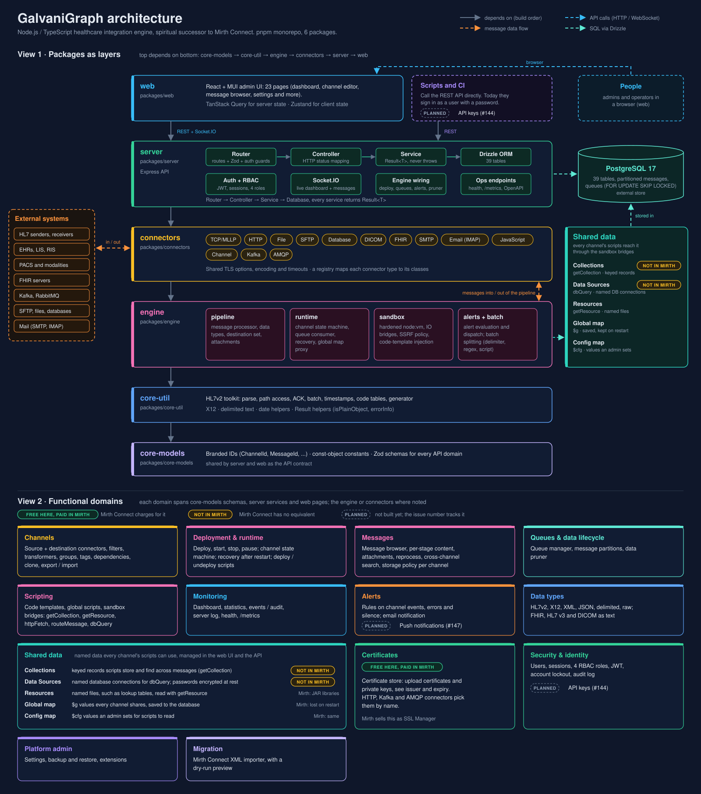

# GalvaniFlow

> A modern, open-source healthcare integration engine. Think Mirth Connect, but built from scratch for Node.js — no Java, no desktop client, no paywall tiers.

**Status: Experimental** — This is a working prototype by a developer with ADD. It might become something great, or it might end up as a really well-architected pile of good intentions. Either way, the code is here and it's free.

## Why?

Mirth Connect (NextGen Connect) is the de facto standard for healthcare integration. It's also:

- **Java** — heavyweight, slow startup, JVM tuning required
- **Swing desktop client** — it's 2026, why do I need a desktop app?
- **Paywalled** — RBAC, MFA, channel history, cross-channel search? That'll be $$$ for the Gold tier
- **Closed direction** — increasingly proprietary with each release

GalvaniFlow keeps what works (channels, transformers, filters, the pipeline model) and rebuilds everything else for the modern era.

## What's Different

- **TypeScript/Node.js** — not Java. Fast startup, npm ecosystem, familiar to web developers
- **Web-based admin** — React + Material UI. No client install. Works on any device with a browser
- **Everything is free** — RBAC, channel history, message search, alerting, certificate management (Mirth's paid SSL Manager) — all built-in, no tiers (MFA is on the roadmap, not yet shipped)
- **Shared data for scripts** — Collections (a keyed record store), Data Sources (named database connections with encrypted passwords) and Resources, managed in the web UI. The global map is saved to the database, so it survives a restart. Mirth has no Collections or Data Sources, and its global map is lost on restart
- **TypeScript in transformers** — write channel scripts in TypeScript with full Monaco editor + autocomplete
- **13ms message processing** — batched CTE queries on native Postgres. Mirth does ~70ms for comparable workloads
- **Real-time dashboard** — WebSocket-driven updates, not polling

## Security model

Channel scripts are isolated on a best-effort basis. The sandbox blocks accidental and casual access to the host, but it is not a security boundary. Treat anyone who can create or edit a channel, code template or global script as able to run code on the GalvaniFlow server.

In practice that means the admin, deployer and developer roles: limit them to people you would trust with a shell on the server. Scripts run in `node:vm` with no `require`, `process` or file system, and reach the network and databases only through the bridges the engine provides. This is an improvement on Mirth Connect and OIE, where Rhino scripts have full Java access by design, but it is not the isolation of a separate process. Process isolation per channel, opt-in and with a performance cost, could be added later for deployments whose script authors are not trusted; it is not built. Details: [SECURITY.md](SECURITY.md) and [`packages/engine/src/sandbox/README.md`](packages/engine/src/sandbox/README.md).

## Quick Start

```bash
# Prerequisites: Node.js 24+, PostgreSQL 17, pnpm 12+

# Clone and install
git clone https://github.com/MichaelLeeHobbs/mirthless.git
cd mirthless
pnpm install

# Set up database
cp .env.example .env        # edit DATABASE_URL if needed
pnpm db:init                # creates user + database
pnpm db:migrate             # applies schema
pnpm db:seed                # seeds admin user + 10 example channels

# Run
pnpm dev                    # starts server (:3000) + web UI (:5173)

# Login: admin / Admin123!
```

### Docker (production)

The production stack (Postgres + server + nginx-served web) is defined in
[`docker/docker-compose.prod.yml`](docker/docker-compose.prod.yml). The server image runs
database migrations and an idempotent seed on start before booting.

```bash
cp .env.production.example .env   # set POSTGRES_PASSWORD, JWT_SECRET, etc.
docker compose -f docker/docker-compose.prod.yml up -d --build
```

The UI and API are served by nginx on port 80 of the host itself (`127.0.0.1`), because that
port is plain HTTP. See [TLS & PHI in transit](docs/ops/tls-and-phi.md) for putting TLS in
front of it, or set `WEB_BIND=0.0.0.0` in `.env` to try it from another machine. Interactive API docs (Swagger UI) are at
**`/api-docs`** (served by the server at `:3000/api-docs`).

### Documentation

- [Quickstart: create your first channel](docs/user/quickstart-first-channel.md)
- [What can GalvaniFlow do, and what is missing?](docs/user/capabilities.md) Every capability with its status, limits, plan and the tests that prove it, including what a Mirth channel imports as.
- [Which connectors can receive, which can send, and what can each do?](docs/user/connector-reference.md#connectors-at-a-glance) Every connector type, its settings and limits.
- [Who can do what? Users, roles, sign-in and cutting someone off](docs/user/access-control.md) The role and permission matrix, sessions, and what is not supported (SSO, MFA, per-channel access).
- [Transformer scripting API](docs/user/scripting-api.md) — the sandbox surface for filters/transformers

### Operations

Running GalvaniFlow in production? See the operator guides in [`docs/ops/`](docs/ops/):

- [Deployment](docs/ops/deployment.md) — first install, required settings, listener ports, known limitations
- [Backup & restore](docs/ops/backup-restore.md) — Postgres `pg_dump`/`pg_restore` plus the config backup API
- [Upgrade procedure](docs/ops/upgrade.md) — migrations, downtime, and rollback
- [TLS & PHI-in-transit](docs/ops/tls-and-phi.md) — edge TLS, connector-level TLS, and how to check TLS is on
- [Access control](docs/user/access-control.md) — roles and permissions, sessions, cutting off a user who left, and where PHI can leave
- [Resource sizing & observability](docs/ops/resource-and-observability.md) — health, `/metrics`, logging, sizing
- [Throughput benchmark](docs/ops/throughput-benchmark.md) — how to measure msgs/sec, with a baseline

### Contributing & Security

- [Contributing guide](CONTRIBUTING.md) · [Code of Conduct](CODE_OF_CONDUCT.md) · [Security policy](SECURITY.md)

## Architecture



The top half shows the packages as layers and what talks to them. The bottom half shows the functional domains, with badges for what Mirth Connect charges for, what it has no equivalent for, and what is planned.

```
packages/
├── core-models/     — TypeScript types, Zod schemas, branded types
├── core-util/       — HL7v2 parser, utilities
├── engine/          — Message pipeline, sandbox, channel runtime
├── connectors/      — TCP/MLLP, HTTP, File, SFTP, Database, JS, Channel, SMTP, FHIR, DICOM, Email, Kafka, AMQP
├── server/          — Express API (131 endpoints), auth, deployment
└── web/             — React + MUI admin UI
```

**Stack:** Node.js, TypeScript (strict), Express, PostgreSQL, Drizzle ORM, React 18, Material UI 6, Vite, Vitest, pnpm workspaces

## Current State

This is a working system with about 2,500 unit tests plus real-Postgres integration and Playwright end-to-end suites. You can create channels, write transformers in TypeScript, deploy them, send messages, and watch them flow through the pipeline. The 10 seeded example channels demonstrate HL7v2, JSON, XML, channel-to-channel routing, filtering, error handling, and more.

What works: channels, pipeline, sandbox, 13 connector types, RBAC, audit logging, message browser, code templates, alerts, groups, tags, dark mode. Scripts and CI use the REST API ([recipes](docs/ops/api-automation.md)).

What's next: visual flow builder (think Node-RED for healthcare), plugin system, clustering. See [ROADMAP](docs/progress/ROADMAP.md).

## License

MIT

---

*Built with an mass amounts of coffee, mass amounts of ADHD, and mass amounts of AI. Healthcare data deserves better tools.*
