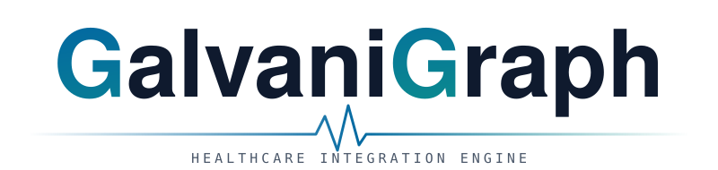
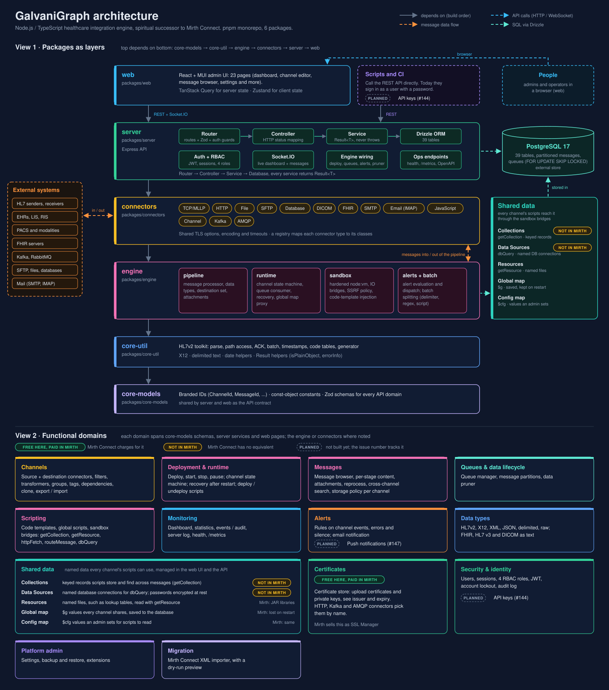

<!--
  Draft of the repository README for the GalvaniGraph rename. It lives here until the rename PR,
  which moves it to /README.md and drops the leading "../" from its links (plan.md, step 2).
  Every claim about GalvaniGraph must match docs/user/capabilities.md; every claim about a
  competitor must carry a dated source in the footnotes. See plan.md, "Claim rules".
-->

<p align="center">
  <picture>
    <source media="(prefers-color-scheme: dark)" srcset="assets/wordmark-dark.svg">
    
  </picture>
</p>

<h3 align="center">GG, Mirth. It was a good game.</h3>

<p align="center">
  The open-source healthcare integration engine for teams who are done paying rent on their interfaces.<br>
  TypeScript end to end. Runs in a browser tab. MIT-licensed, so it stays free.
</p>

<p align="center">
  
  
  
  <a href="https://github.com/MichaelLeeHobbs/mirthless/actions/workflows/ci.yml"></a>
</p>

---

## Game over

In March 2025 NextGen closed the source of Mirth Connect. Version 4.5.2 was the last open release, and everything after it needs a commercial license.[^mirth] The features people actually wanted, like role-based access, the SSL Manager, cross-channel search and the FHIR connector, were already behind paid tiers before that.

That was the free option.

## And don't get us started on Rhapsody

Fine. We'll start.

Rhapsody's hosted engine lists on AWS Marketplace at **$50,000 a year** for one production license and five connections. Five. Corepoint, from the same company, lists at **$60,000**. Your sixth connection is a call to sales.[^rhapsody]

GalvaniGraph lists at **$0** for as many connections as your server can carry. The source is in this repository, and it stays here.

## GG at a glance

| | GalvaniGraph | Mirth Connect 4.6 and later |
|---|---|---|
| Price | $0, MIT license | Commercial license |
| Source code | Public, all of it | Closed since 4.6 |
| Admin console | Any browser, phone included | Java desktop Administrator and its launcher |
| Scripting | JavaScript or TypeScript in a Monaco editor with autocomplete | Rhino JavaScript and E4X |
| Role-based access | Included, four roles | Paid tier |
| Certificate manager | Included | Paid (SSL Manager) |
| Search across channels | Included | Paid |
| FHIR destination | Included | Paid |
| Global map after a restart | Kept, saved to PostgreSQL | Gone |
| Shared data for scripts | Collections, Data Sources, Resources | No equivalent |
| Kafka and RabbitMQ | Source and destination | Not built in |
| Script isolation | `node:vm`, no `require`, `process` or file system | Full Java access, by design |

Thirteen connector types ship today: TCP/MLLP, HTTP, File, SFTP, Database, JavaScript, Channel, SMTP, Email, FHIR, DICOM, Kafka and AMQP. Mirth channel exports and server backups import directly, with a dry-run preview that tells you what will need attention before you commit.

## What we don't have yet

Here's something a vendor sales page won't do: list what's missing.

- No single sign-on, LDAP or MFA. Mirth charges for these; we haven't built them.
- No SQL Server or Oracle connector. PostgreSQL, MySQL and MariaDB work.
- No clustering or failover. Run one node.
- Mirth scripts that use E4X or Mirth's Java helper APIs need rewriting. The import preview names every construct it finds.

The full list lives in [one page](../user/capabilities.md): every capability, its status, its limits, the issue that tracks the gap, and the test that proves it. A row that says **Yes** has a test in CI behind it.

## Run it

```bash
# Prerequisites: Node.js 24+, PostgreSQL 17, pnpm 12+
git clone https://github.com/MichaelLeeHobbs/mirthless.git
cd mirthless
pnpm install

cp .env.example .env        # edit DATABASE_URL if needed
pnpm db:init                # creates the user and database
pnpm db:migrate             # applies the schema
pnpm db:seed                # admin user and 10 example channels

pnpm dev                    # server on :3000, web UI on :5173
# Sign in as admin / Admin123!, then change it
```

The ten seeded channels cover HL7 v2, JSON, XML, channel-to-channel routing, filtering and error handling. Send one a message and watch it move.

For production, [`docker/docker-compose.prod.yml`](../../docker/docker-compose.prod.yml) runs Postgres, the server and nginx. Start with the [deployment guide](../ops/deployment.md).

## Security model

Channel scripts run in `node:vm` with no `require`, `process` or file system, and reach the network and databases only through bridges the engine provides. That is a real step up from Mirth and its forks, where Rhino scripts get the whole JVM. It is still not a security boundary: treat anyone who can edit a channel, code template or global script as someone who can run code on the server, and give the admin, deployer and developer roles only to people you'd trust with a shell. Details in [SECURITY.md](../../SECURITY.md) and the [sandbox README](../../packages/engine/src/sandbox/README.md).

## Read more

- [Your first channel](../user/quickstart-first-channel.md)
- [What GalvaniGraph can do, and what it can't](../user/capabilities.md)
- [Connector reference](../user/connector-reference.md)
- [Users, roles and permissions](../user/access-control.md)
- [Scripting API](../user/scripting-api.md)
- [Operator guides](../ops/): deployment, backup and restore, upgrades, TLS, sizing and metrics
- [Contributing](../../CONTRIBUTING.md) · [Code of Conduct](../../CODE_OF_CONDUCT.md) · [Security policy](../../SECURITY.md)

## Under the hood



```
packages/
├── core-models/   TypeScript types, Zod schemas, branded types
├── core-util/     HL7 v2 parser and shared helpers
├── engine/        message pipeline, script sandbox, channel runtime
├── connectors/    the 13 protocol adapters
├── server/        Express REST API, auth, deployment
└── web/           React and Material UI admin console
```

Node.js, strict TypeScript, Express, PostgreSQL, Drizzle, React, Material UI, Vite and Vitest. About 2,500 unit tests, plus integration suites against real Postgres and protocol servers, and Playwright end to end. Every one runs in CI.

## License

MIT. Take it. That's the point.

---

<sub>Built on coffee, ADHD and AI, because healthcare data deserves better tools. GG.</sub>

<sub>Mirth and Mirth Connect are trademarks of NextGen Healthcare. Rhapsody and Corepoint are trademarks of their owner. GalvaniGraph is an independent project with no affiliation to either.</sub>

[^mirth]: NextGen Healthcare, [Mirth Connect downloads](https://www.nextgen.com/products-and-services/mirth-connect-downloads) and [A new era for Mirth Connect](https://www.nextgen.com/blog/industry-news/a-new-era-for-mirth-connect-by-nextgen-healthcare). Checked 2026-11-15.
[^rhapsody]: AWS Marketplace list prices, 12-month contracts, checked 2026-11-15: [Rhapsody as a Service](https://aws.amazon.com/marketplace/pp/prodview-ox6d5ynatj5l2), $50,000 for "1 Production License with up to 5 comm points"; [Corepoint as a Service](https://aws.amazon.com/marketplace/pp/prodview-dto3okvvw5wzo), $60,000 for the same. Both pages say further licensing needs a private offer. On-premises pricing is by quote and not public.
